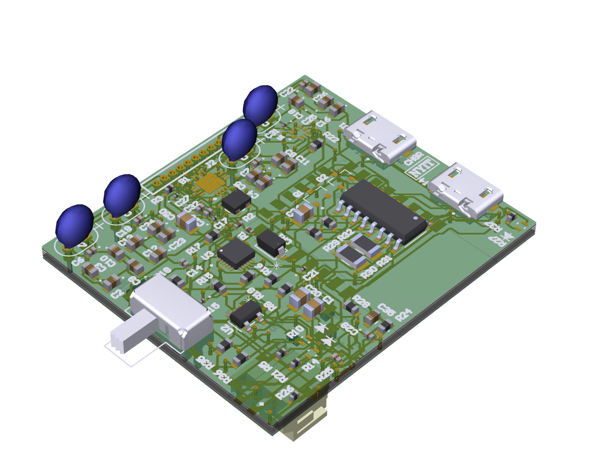
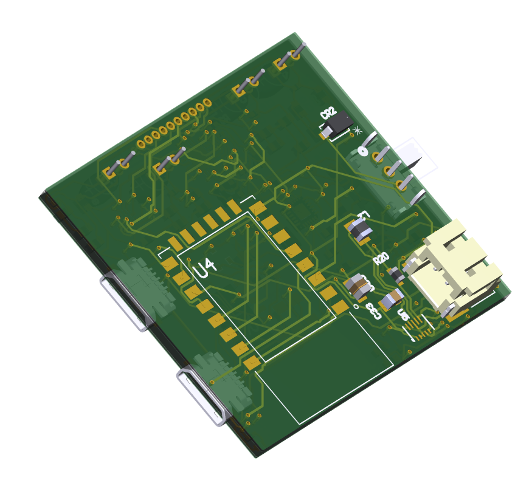
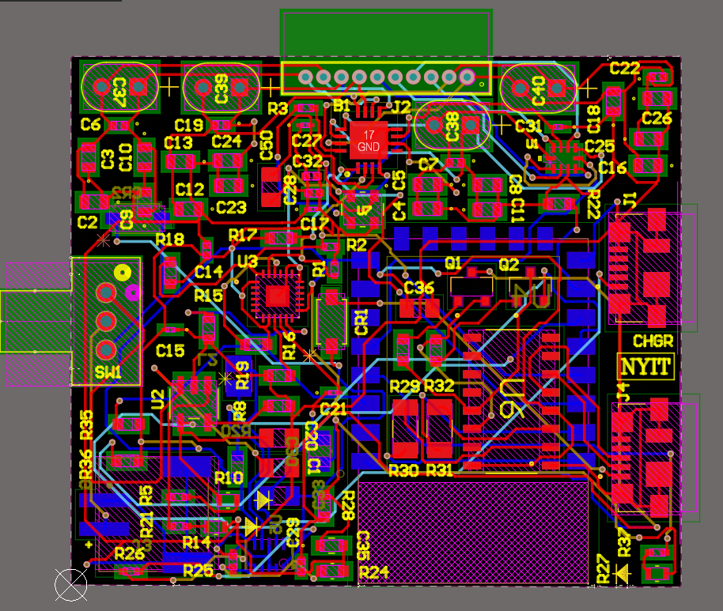
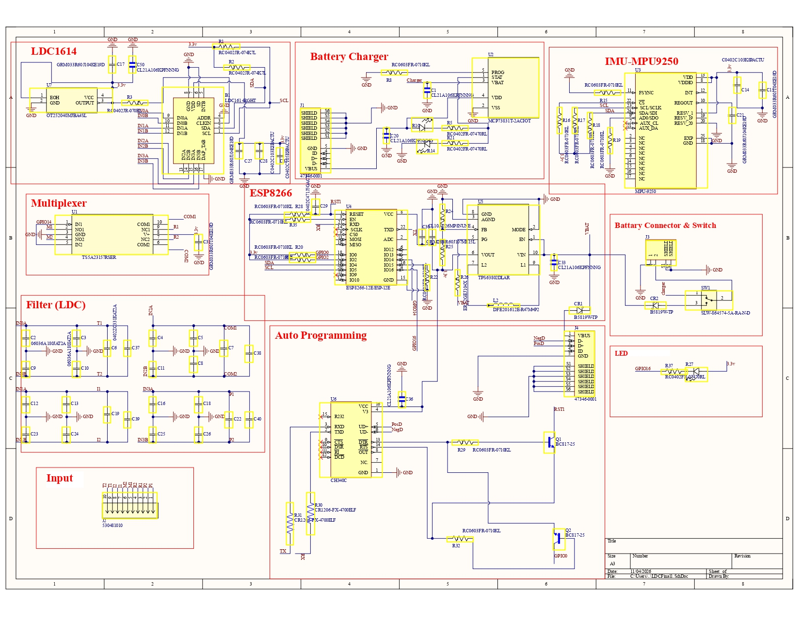

# Haptic Glove Data Acquisition Board

A 4-layer, double-sided sensor data acquisition PCB designed for a **closed-loop soft robotic haptic glove** and its **pneumatic control system**. The board reads multiple sensor channels, processes them on an ESP8266 microcontroller, and is powered directly from a single 3.7V Li-ion battery with an on-board charger, making it compact and suitable for wearable use.

Designed in **Altium Designer**: schematic capture, PCB layout, and BOM creation.

 
 
 
## Key Features

- **Automatic code upload:** The ESP8266 includes an auto-reset/boot circuit driven by the USB-to-serial interface. Firmware can be flashed over USB directly from the IDE, with no need to manually press BOOT and RESET buttons.
- **Regulator-free power design:** The power section is designed so the board runs directly from a single 3.7V Li-ion cell, with no additional voltage regulator. This reduces part count, board area, and power loss.
- **Integrated Li-ion charger:** The battery charging circuit is built into the board, so the battery can be recharged without removing it from the glove.
- **Differential multiplexing:** Sensor signals are routed through a differential multiplexing scheme to reduce crosstalk between channels and improve signal integrity.
- **4-layer, double-sided board:** Dedicated ground and power planes improve noise performance, and components are placed on both sides to keep the board compact.

---

## Layer Stackup

| Layer | Function |
|-------|----------|
| L1 – Top Layer | Signal routing + components |
| L2 – GND | Solid ground plane |
| L3 – Power | Power distribution plane |
| L4 – Bottom Layer | Signal routing + components |

---
## PCB Layout

## Schematic

Full schematic: [Haptic_System_Schematic.pdf](docs/Haptic_System_Schematic.pdf)

